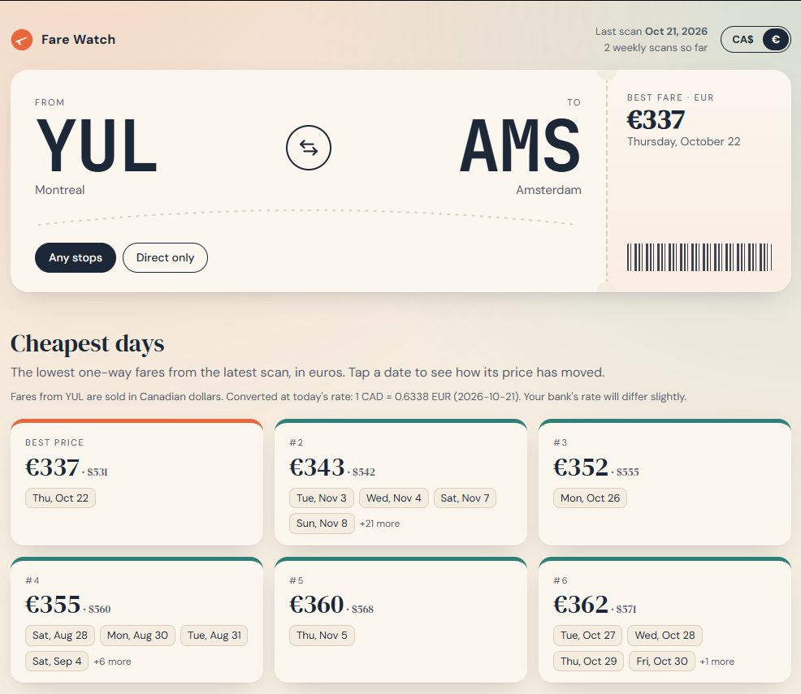

# Flight Tracker

A self-hosted flight price tracker running on my home Ubuntu server, with a public website to browse the results.

**Live:** [flights.ricamivida.com](https://flights.ricamivida.com)

Every Wednesday it scans one-way fares between Montreal (YUL) and Amsterdam (AMS) in both directions for the next 11 months, separating direct flights from options with layovers. Prices are stored in PostgreSQL, explored privately in Grafana, and shown publicly on **Fare Watch**, a small web app I built for it.



## Fare Watch (the website)

- **Boarding-pass header** to flip the direction (YUL → AMS or AMS → YUL) and choose any stops or direct only
- **Cheapest days** from the latest scan, with days at the same price grouped on one card
- **11-month calendar** colored from cheap to expensive, so cheap stretches stand out at a glance
- **Price history** for any day you click, one point per weekly scan
- **One currency for both directions.** Fares from Amsterdam are sold in euros and fares from Montreal in Canadian dollars, so everything is converted to the currency you pick (CAD by default) using the daily European Central Bank rate. The original price stays visible next to the converted one.
- Choices live in the URL (for example `#AMS-YUL/direct/EUR`), so a link opens exactly the same view
- Works on phones


## Stack

- **Python**: collects fares from the Ignav flight price API
- **PostgreSQL**: stores the price history
- **FastAPI**: small read-only API behind the website
- **HTML, CSS and plain JavaScript**: the page itself, no framework, charts drawn as SVG
- **Grafana**: private dashboard with a price chart, cheapest months and cheapest days
- **Docker Compose**: runs everything
- **Caddy**: reverse proxy with automatic HTTPS for the public site
- **cron**: schedules the weekly scan

## How it fits together

```
 cron (Wednesdays) ─► scanner.py ─► Ignav API
                          │
                          ▼
                     PostgreSQL ◄── read-only users ──┬── Grafana (private, home only)
                                                      └── Fare Watch API (FastAPI)
                                                              │
 Internet ─► router (80/443) ─► Caddy (HTTPS) ─► Fare Watch page + API
                                                              │
                                              Frankfurter (daily EUR/CAD rate)
```

## Design decisions

- **The website can only read.** It connects with its own `web_reader` database user that has `SELECT` on two tables and nothing else, and every query also runs in a read-only transaction. Even a bug in the site can't change or delete prices.
- **Only known values reach the database.** Routes and stop types are checked against a fixed list before any query runs, and all queries use parameters, never string building.
- **Hardened container.** The web app runs as a non-root user in a read-only container.
- **Exchange rate cached.** The rate is fetched at most every 6 hours, sanity-checked, and the last good value is kept if the rate service is down. If no rate is available at all, prices fall back to the currency the airline sells in, with a note.
- **No live API calls from visitors.** The site only shows what the weekly scan stored, so strangers browsing the site never spend paid API requests.
- **Works from inside the home network too.** The router can't loop traffic back to its own public IP, so Pi-hole answers the site's domain with the server's local address for devices at home.

## Files

- `scanner.py`: weekly one-way scan (cheapest price per day, direct vs any stops)
- `collector.py`: detailed round-trip check for specific dates
- `schema.sql`: database tables
- `web/app.py`: the Fare Watch API
- `web/static/index.html`: the Fare Watch page
- `grafana/provisioning/`: Grafana data source configuration

## API

| Endpoint | Returns |
|---|---|
| `GET /api/meta` | routes, currencies, last scan date, number of scans |
| `GET /api/calendar?route=YUL-AMS&stops=any` | latest price for every upcoming day |
| `GET /api/cheapest?route=AMS-YUL&stops=direct&limit=6` | cheapest prices, equal prices grouped |
| `GET /api/history?route=YUL-AMS&stops=any&date=2026-12-10` | one day's price, scan after scan |
| `GET /api/rates` | today's EUR/CAD rate |
| `GET /health` | app and database status |

## Setup

1. Copy `.env.example` to `.env` and fill in your own values
2. `docker compose up -d db grafana` to start the database and Grafana
3. Create the read-only user for the website:
   ```bash
   docker exec -i flight-db psql -U flights -d flights -v pw="$(grep '^WEB_DB_PASSWORD=' .env | cut -d= -f2)" <<'SQL'
   CREATE ROLE web_reader LOGIN PASSWORD :'pw';
   GRANT CONNECT ON DATABASE flights TO web_reader;
   GRANT USAGE ON SCHEMA public TO web_reader;
   GRANT SELECT ON fare_calendar, prices TO web_reader;
   SQL
   ```
4. `docker compose up -d --build web` to start Fare Watch on port 8097
5. `docker compose run --rm tracker` to run a scan

## Next

- Show which airline offers each price, and the stops for trips with layovers
- Price drop alerts
